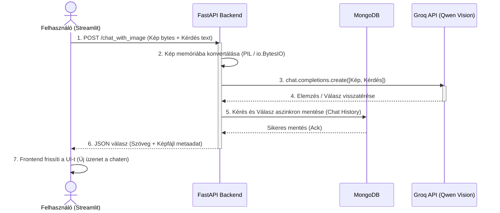

A forrásokról, a licencről és a saját fejlesztésekről részletesen a CREDITS.md fájlban olvashatsz

# Projekt előrehaladása

### 📌 Elvárások a beadandóval kapcsolatban:
* **Patch (Minimum szint):** A meglévő projekt leágaztatása (forkolása) és átültetése egy másik környezetbe (például Groq alapokra)
* **Minor (Középszint):** A meglévő funkciók továbbfejlesztése és kiegészítése (például RAG-alapú kontextusbevonás a képelemzés során).
* **Major (Haladó szint):** Teljesen új funkció vagy alrendszer implementálása (például a WALDO finder modul felépítése).

### 📌 Összegzés a beadandó struktúrájához:
Megjegyzés a feltöltésekhhez: Kép és videófeltöltés esetében a fájlméret nem haladhatja meg az 50 MB-t. Kép esetében a kiterjesztés JPG, JPEG vagy PNG a megengedett, míg videó esetében MP4 vagy MKV az elfogadott.
* **1. modul:** 3 funkcióból tevődik össze: 1. Lehetőség nyílik 3 kép feltöltésére, amit a Groq Qwen elemez. 2. A megadott szöveges leírás alapján a beküldött képből kivág egy kisebb részt 3. A "Depth Anything V2" használatával mélységtérképet generál az MI a beküldött kép alapján.
  
* **2. modul:** Waldo kereső. Lehetőség van saját kép feltöltésére, vagy a gyökérmappában találató waldo_puzzle.jpg, waldo_character.jpg, waldo_solution.jpg-n keresi meg Waldo-t. Működés: 3 modell versenyez egymással: Gemini 3.5, Groq Qwen 3.8, Nvidia Nemotron 3.5. Mindegyik modul megkapja először a szöveges promtot és megpróbálja megkeresni a képen Waldo-t, majd a második keresés előtt megkapja waldo_character.jpg képét és az alapján is megpróbálja még egyszer megkeresni. Szerzői jogokra hivatkozva nem töltöm fel ebbe a nyilvános projektbe Waldo képeket.
  
* **3. modul:** Számla & Nyugta feldolgozó AI modul. 1. funkció: A Qroq elemzi a beküldött képet ha nem számla vagy nyugta visszajelzést kap a felhasználó. Ha számla vagy nyugta, akkor a dokumentumon lévő adatok egy részét MongoDB adatbázisba helyezi el. 2. funkció: Az adatbázisban lévő adatokat elemzi és szöveges visszajelzést ad róla.
  
* **4. modul:** Sakk az AI-al. 1. funkció: egy sakk állást tartalmazó képet beküldve a Groq és a Gemini elemzi a képet és megadja, hogy melyik a legjobb lépés. 2. funkció: a Gemini és a Groq egymás ellen játszik a sakk szabályai szerint. 3. funkció a felhasználónak lehetősége van játszani a világ legerősebb sakkmotorjával, a Stockfish19, amit a Groq Qwen kommentál. Szükséges lépés: stockfishchess.org/download a fájlokat le kell tölteni és el kell helyezni az alkalmazás gyökérkönyvtárában az /engines mappában és az indítófájlt (exe) át kell nevezni stockfish.exe-re a funkció használatához.
  
* **5. modul:** Lehetőség van videók feltöltésére, a feltöltött videót elemzi a Groq. Mőködés: kiírja a videóban elhangzott szöveget és a videóból származó 3 db kép tartalmát leírja.
---

# Komplex MI alkalmazások fejlesztése

A projekt célja, hogy a hagyományos "Jupyter Notebook" szintű kísérletezésen túllépve, egy valós, skálázható szoftverarchitektúrát hozzunk létre, amely egy FastAPI backendből, egy Streamlit frontendből, valamint több adatbázisból áll.

---

## Technológiai Stack és Architektúra

A projekt a legmodernebb ipari standardokra épül:
* **Környezet**: Docker Compose (Python App + MongoDB konténerek közös hálózaton).
* **Backend:** `FastAPI` (Aszinkron API), `Motor` (Aszinkron MongoDB driver) és `Pillow` (Memórián belüli képkezelés).
* **Frontend:** `Streamlit` (Modern, Python-alapú chat UI).
* **Adatbázis:** `MongoDB` (munkameneteknek és chat logoknak)
* **MI Integráció:** `groq` Python SDK (`AsyncGroq` és Qwen multimodális modellek).
* **Sakk-motor**: Stockfish: stockfishchess.org/download

---

## Fejlesztői Környezet Indítása

### 1. Előfeltételek és Beállítások

### Lokális futtatás (`start.py` szkripttel)
- **MongoDB**: Helyileg telepítve kell lennie a gépeden (és futnia kell a `localhost:27017` porton).
- **Python 3.10+**: A helyi szkriptekhez és a Streamlit frontendhez. Pycharm használata esetében be kell állítani az interpretert és a külső könyvtárakat telepíteni kell(`pip install -r requirements.txt`).
- **Groq API Kulcs**: Szerezz be egyet a [Groq Console](https://console.groq.com/)-ról és írd be a .env fájlba.
- **További API Kulcsok**: Tekintsd meg az .env.example fájlt

példa:
```.env
GROQ_API_KEY=gsk_saját_groq_kulcsod_ide
```

## 2. A Szolgáltatások Futtatása (`start.py`)
**start.py**, amely egyszerre indítja a frontendet és a backendet az alkalmazás gyökérmappájában található. Ez automatikusan megnyitja a böngészőben a Streamlit alkalmazást (jellemzően a http://localhost:8501 címen). Az alkalmazás korlátlan működéséhez ekkor szükség van egy telepített MongoDB futtatáshoz is.


### 3. Multimodális Gépi Látás (Vision)
A rendszer képes képeket (számlákat, diagramokat, vizuális adatokat) fogadni és feldolgozni a Qwen modell segítségével, ami közvetlenül strukturált adatokat vagy elemzést generál a bináris fájlokból.

###  Az Adatfolyam Vizualizációja (Multimodális Látvány)
Az alábbi ábra bemutatja, hogyan utazik egy képes-szöveges kérés a kliensgéptől egészen az MI szerveréig és vissza:


## Project struktúra

```
/
├── start.py                # Egységes indító szkript (Backend + Frontend)
├── backend/
├── client/                  # Streamlit UI (Feltöltés, Chat és Waldo modul)       
├── requirements.txt        # Függőségek (FastAPI, Streamlit, motor, chromadb, groq stb.)
├── docker-compose.yml
├── Dockerfile
└── .env                    # API kulcsok (NE KÜLDD BE GITHUB-RA!)
```
---

## ⚠️ Ismert jelenségek és hibatűrés (Groq LPU Alapokon)

Mivel az alkalmazás a **Groq felhőszolgáltatására** és a **Qwen multimodális modellekre** támaszkodik, előfordulhatnak átmeneti terhelési tüskék vagy korlátozások:

- **HTTP 429 (Rate Limit / Túl sok kérés):** 
  A Groq API percenkénti kérés- (RPM) vagy tokenkorlátba (`TPM`) ütközhet, ha túl sűrűn küldesz kéréseket (különösen nagy méretű képek elemzésekor). 
  * *Megoldás:* Várj 10-20 másodpercet, amiből a token-kvóta automatikusan feltöltődik, majd próbáld újra.
  
- **HTTP 503 / 502 (Szerveroldali leterheltség):** 
  A Groq LPU szerverei vagy a modell hosztolása átmenetileg nem elérhető. 
  * *Megoldás:* A kódodban lévő `tenancy` retry mechanizmus automatikusan megpróbálja újra 3 alkalommal, de ha manuálisan is hibát kapsz, ismételd meg a műveletet pár másodperc múlva.

- **Képformátum vagy méret hiba:** 
  Ha a feltöltött képnél hiba lép fel, ellenőrizd, hogy a fájl kiterjesztése szabványos `jpg`, `jpeg` vagy `png` legyen, és a fájlméret ne lépje túl a megengedett kereteket.
